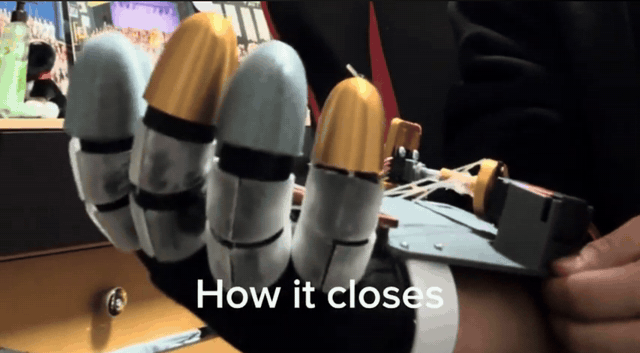
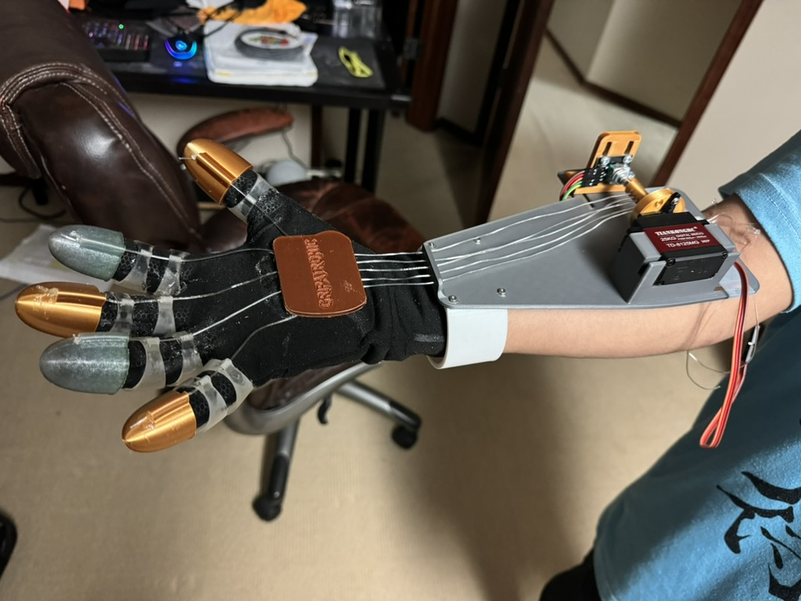
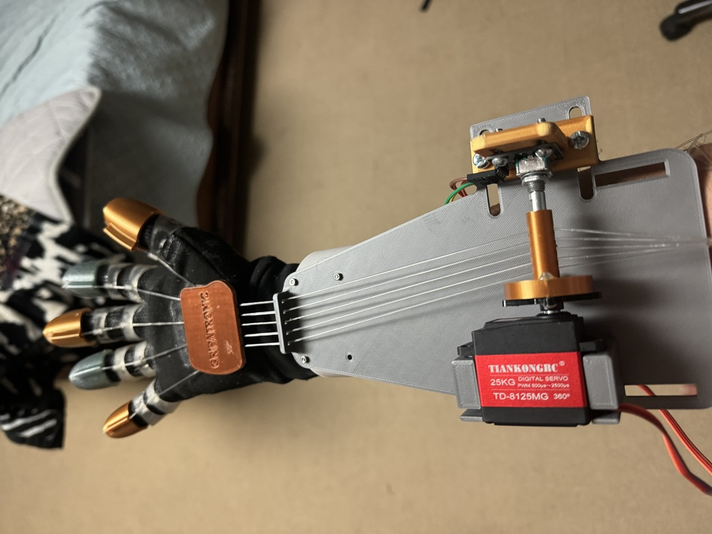
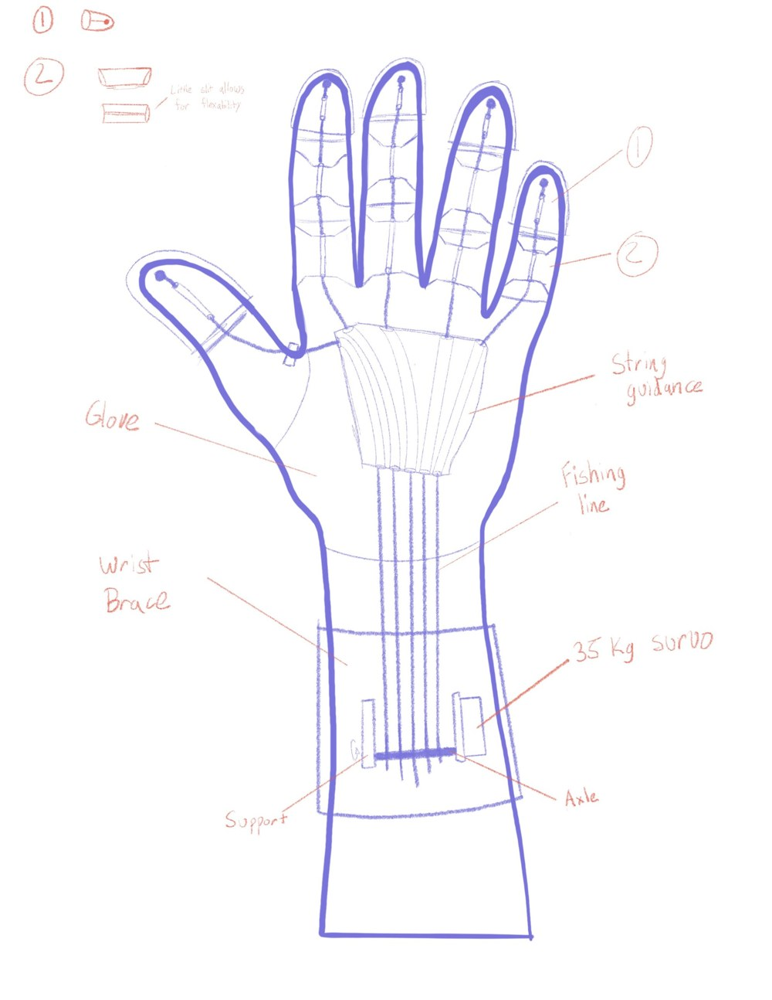

# Gripatronic: Grip-Assist Glove (v1)

A tendon-driven glove I designed and built in high school to help the wearer close their hand. Proof-of-concept prototype, awarded the Apostoli Marinakos MYP Personal Project Award.

**Project page:** [krishneet.com/the-gripatronic](https://krishneet.com/the-gripatronic/) · **Full report:** [Gripatronic-Project-Report.pdf](Gripatronic-Project-Report.pdf)

## How it works

- **Tendons:** fishing line runs from 3D-printed fingertip caps through finger guides to a single spool on the forearm. The thumb's line is redirected with a hinge, since it closes at a different angle from the other fingers.
- **Actuation:** a 25 kg·cm continuous-rotation servo winds the spool to curl the fingers.
- **Sensing:** a rotary encoder on the spool shaft counts rotations, so the Arduino Nano stops the servo at a set closure.
- **Safety:** a push-button emergency stop. I also chose a 25 kg·cm servo over a 35 kg·cm one so the wearer can overpower it.
- **Design:** modeled in Fusion 360 from caliper measurements of my hand, printed in PLA.

*Original concept sketch: fingertip caps, flexible finger rings, string guide, and the spool axle on a wrist brace.*

## Problems I solved

- **The spool axle snapped under tendon load.** I reprinted it with much higher infill.
- **Screws wouldn't hold in the printed holes,** and enlarging the holes let the parts wobble. I modeled threaded holes instead.
- **Tendons tangled on the spool.** I switched to a lower-friction line on advice from Trent Shumay, the creator of DexHand.

## Limitations

- It closes only. The tendons have to be unwound by hand.
- One spool drives all five fingers, so the fingers can't move independently and the tension is uneven.
- There's no force sensing, so it can't tell what it's gripping.

These are what my next project, **Haptic Teleop Arm**, is built to fix.
